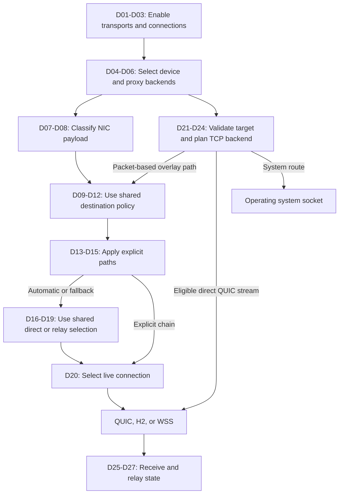

# Decision map

LowTier has many decisions that select a function or a data path.
This map identifies 27 routing and implementation boundaries in seven areas.
Each site is a named boundary with one or more conditions.
The count does not measure every `if`, every `match`, or every possible path combination.
Three shared selection functions now replace repeated policy checks.
The proxy cleanup also removes six fixed internal settings and unreachable authentication alternatives.

The map describes the source inspected on November 15, 2026.
It covers startup, network devices, forwarding, connection selection, proxies, and receive processing.
It does not inventory management commands, GUI handlers, every discovery strategy, or transport framing internals.

## Main data flow

The diagram shows dependencies between decisions.
Some decisions run at startup.
Others run for each connection, flow, batch, or packet.
An explicit chain selects connections for its successive hops.
It does not replace transport authentication or relay session checks.

## Startup and transports

### D01: Transport activation

**Source:** [Instance::new](../../lowertier/src/instance/instance.rs#L220), [transport_protocol_enabled](../../lowertier/src/common/config.rs#L82).

An empty `enabled_protocols` list permits all supported transports.
QUIC punching requires QUIC activation and enabled UDP punching.
TCP punching requires H2 or WSS activation and enabled TCP punching.
Disabled punchers remain absent instead of running inactive background state.
This decision occurs during instance construction.

### D02: Connector and listener factories

**Source:** [create_connector_by_url](../../lowertier/src/connector/mod.rs#L383), [create_listener_by_url](../../lowertier/src/instance/listeners.rs#L100).

Both factories reject disabled protocols.
The URL scheme then selects one implementation:

| Scheme | Connector | Listener |
| --- | --- | --- |
| `quic` | `QuicTunnelConnector` | `QuicTunnelListener` |
| `h2` | `TcpTunnelConnector` | `TcpTunnelListener` |
| `wss` | `WsTunnelConnector` | `WsTunnelListener` |

The connector also validates underlay addresses before creating its selected transport.
These decisions occur when a listener or outgoing connection is created.

### D03: Direct connection eligibility and background attempts

**Source:** [should_try_p2p_with_peer](../../lowertier/src/connector/mod.rs#L162), [should_background_p2p_with_peer](../../lowertier/src/connector/mod.rs#L180).

Public servers require `allow_public_server`.
Remote `need_p2p` can permit an attempt when the local P2P mode is `Off`.
Remote `disable_p2p` blocks attempts unless the local mode is `Required`.
With no remote feature flags, every local mode except `Off` permits an attempt.
`Lazy` mode suppresses background attempts unless the remote peer requires P2P.
Eligibility and background scheduling are separate decisions.

## Network devices and proxy state

### D04: Network device backend

**Source:** [InterfaceAdapter::automatic](../../lowertier/src/common/config.rs#L255), [VirtualNic::create_dev](../../lowertier/src/instance/virtual_nic.rs#L1000), [wrap_tun_device](../../lowertier/src/instance/virtual_nic.rs#L526).

Linux and FreeBSD select the TAP adapter.
Other targets select the TUN adapter.
On Linux, device creation first tries the configured offload setting.
An offload failure permits a second attempt without offload.
A remaining Linux backend failure uses the `rust-tun` fallback.
Apple targets use the Darwin device wrapper.
These are platform and resource decisions during device creation.

### D05: Inner IP proxy activation

**Source:** [IpProxy::start](../../lowertier/src/instance/ip_proxy.rs#L41).

An instance with no exported CIDRs, no exit service, and a TUN device skips protocol proxy allocation.
System forwarding also skips this allocation when a TUN device exists.
Otherwise, `OnceLock` values create TCP, UDP, and ICMP proxy state.
A lock and the `started` flag prevent duplicate startup.
This decision controls resource ownership.

### D06: Kernel or userspace TCP proxy listener

**Source:** [TcpProxy::get_proxy_listener](../../lowertier/src/gateway/tcp_proxy.rs#L572).

With the `smoltcp` feature, no-TUN operation selects `SmolTcpListener`.
iOS and the macOS Network Extension also select this listener.
Other cases select `KernelTcpListener`.
This selects the inner TCP stack.
It does not select the overlay transport.

## Payloads and destinations

### D07: IP or Ethernet fabric entry

**Source:** [NicCtx::do_forward_nic_batch_to_peers](../../lowertier/src/instance/virtual_nic.rs#L1318), [PeerManager::send_fabric_batch](../../lowertier/src/peers/peer_manager.rs#L5706).

A native Ethernet adapter creates `FabricPayloadKind::Ethernet`.
Other adapters create `FabricPayloadKind::Ip`.
`send_fabric_batch` dispatches these kinds to `send_msg_by_hybrid_ethernet_batch` or `send_msg_by_hybrid_ip_batch`.
This is a payload representation decision for each batch.

### D08: Ethernet control, IP, or complete Ethernet

**Source:** [send_msg_by_hybrid_ethernet_batch](../../lowertier/src/peers/peer_manager.rs#L5726).

Source admission runs before local control handling.
A handled neighbor control frame stops at the local handler.
Recognized IPv4 and IPv6 EtherTypes enter the compact IP processing path after basic validation.
Other EtherTypes enter complete Ethernet forwarding.
Malformed frames return errors or are rejected by admission.
NIC transforms and ACL processing precede later recipient selection.

### D09: Shared IP destination policy

**Source:** [resolve_ip_destination](../../lowertier/src/peers/peer_manager.rs#L5550), [hybrid_destination_from_packet_snapshot_with_synced_routes](../../lowertier/src/peers/peer_manager.rs#L5529), [hybrid_destination_from_snapshot](../../lowertier/src/peers/peer_manager.rs#L5446).

The packet adapter accepts a nonzero header destination before applying IP policy.
The shared resolver then applies these decisions:

1. An eligible explicit CIDR gateway selects its configured peer.
2. A selected service route supplies `Forward`, `ExitSnat`, or `Blackhole`.
3. The snapshot helper resolves the remaining destination.

The snapshot helper handles multicast and broadcast before unicast lookup.
Unicast checks the peer address, exported subnet, public IPv6 gateway, and configured internet gateway.
Overlay and link-local address rules restrict gateway use.
The result has three variants: `Forward`, `Blackhole`, and `Unresolved`.
Both packet routing and proxy routing use this result.

### D10: Service route selection

**Source:** [ServiceRouteSnapshot::candidates](../../lowertier/src/peers/service_route.rs#L93), [ServiceRouteStore::select_gateway](../../lowertier/src/peers/service_route.rs#L198).

The route snapshot supplies the longest matching prefix.
The selector keeps live gateways and blackhole routes.
It selects the highest preference, then the lowest metric.
A valid cached plan or eligible flow pin retains the existing choice.
Otherwise, the existing flow score selects among equal candidates.
Snapshot generation, pin age, and gateway liveness control reuse.

### D11: Proxy route adapter

**Source:** [PeerManager::plan_user_route](../../lowertier/src/peers/peer_manager.rs#L5587).

The proxy planner synchronizes service routes and refreshes configured paths.
It then calls the shared D09 resolver.
Its output selects `UserRoutePlan::Overlay`, `UserRoutePlan::Blackhole`, or `UserRoutePlan::System`.
An `Unresolved` result normally permits the system route.
A strict internet rule can turn that result into `Blackhole`.
The adapter retains the proxy fallback contract without repeating destination policy.

### D12: Compact IP and complete Ethernet recipients

**Source:** [hybrid_compact_unicast_peer](../../lowertier/src/peers/peer_manager.rs#L5158), [hybrid_recipient_sets](../../lowertier/src/peers/peer_manager.rs#L5186), [route_requires_full_ethernet](../../lowertier/src/peers/peer_manager.rs#L5100).

A single eligible unicast recipient can use compact IP.
Other cases build separate compact and complete Ethernet recipient sets.
The choice depends on peer capabilities, bridge authority, multicast, broadcast, and the forwarding database.
An unknown unicast can use an authorized bridge or the permitted bridge fallback.
Fanout admission limits replicated output.
These decisions preserve Ethernet semantics and authorization.

## Explicit path policy

### D13: Path rule precedence

**Source:** [PathRuntime::rule_for_destination](../../lowertier/src/peers/path_policy.rs#L903), [rule_for_address](../../lowertier/src/peers/path_policy.rs#L892).

Peer selection checks an exact peer rule first.
It then checks a gateway rule with relay layers for that peer.
It finally checks the wildcard peer rule.
Address selection uses the longest matching CIDR rule.
A packet's previously selected `path_rule` can carry that address rule into the sender.

### D14: Relay group mode

**Source:** [PathRuntime::pick_one](../../lowertier/src/peers/path_policy.rs#L776), [expand_rule_chains](../../lowertier/src/peers/path_policy.rs#L934), [PathPolicy::rule](../../lowertier/src/peers/path_policy.rs#L357).

`Failover` selects the first usable member.
`Flow` selects one member with the existing weighted flow score.
`Parallel` expands usable layer combinations into candidate chains.
Gateway stages configured as `Parallel` become `Flow` to preserve connection affinity.
Reachability, relay capability, and loop exclusions remove unusable members.
The runtime retains at most 16 active chains.

### D15: Explicit chain result

**Source:** [PathRuntime::plan_for_destination](../../lowertier/src/peers/path_policy.rs#L1147), [PeerManager::send_path_packets](../../lowertier/src/peers/peer_manager.rs#L4189).

| Condition | Plan | Sender action |
| --- | --- | --- |
| Missing resolved policy, missing rule, or no relay layers | `Automatic` | Return the packet to automatic dispatch |
| No usable chain and `strict = false` | `Fallback` | Return the packet to automatic dispatch |
| No usable chain and `strict = true` | `Drop` | Consume the packet without sending |
| One usable chain | `Single` | Send through that chain |
| More than one usable chain | `Parallel` | Schedule packets across candidate chains |

Only local, unencrypted `Data`, `Ethernet`, and `OverlayStream` packets enter this explicit path planner.
`send_path_packets` returns remaining automatic packets to its caller.
Errors during an attempted chain send are reported to the caller.
This table describes planning fallback, not a general retry after every send error.

## Automatic forwarding and connections

### D16: Packet next-hop policy

**Source:** [PeerManager::get_next_hop_policy](../../lowertier/src/peers/peer_manager.rs#L3707).

Control traffic selects `ControlHop`.
Data marked `speed_first` selects `MaxGoodput`.
Otherwise, data marked `latency_first` selects `LeastCost`.
Other data selects `LeastHop`.
Packet classification takes precedence over the data preference flags.

### D17: Automatic route algorithm and table fallback

**Source:** [RouteTable::build_automatic_next_hops](../../lowertier/src/peers/peer_route.rs#L4109), [ForwardingDecisionSnapshot::next_hop](../../lowertier/src/peers/route_trait.rs#L421).

`ControlHop` builds a least-hop map from the control graph.
`LeastHop` and `LeastCost` use their corresponding data graph algorithms.
`MaxGoodput` builds the checked widest-path map from the directed speed graph.
Published data maps restore direct edges before relay choices.
Snapshot lookup rejects suppressed peers.
Goodput lookup falls back to cost, then hops.
Cost lookup falls back to hops.
Control lookup uses its separate control map.

### D18: Shared direct or relay selection

**Source:** [resolve_peer_send_target](../../lowertier/src/peers/peer_manager.rs#L4829), [authorize_peer_send](../../lowertier/src/peers/peer_manager.rs#L4806), [send_ordered_peer_batches](../../lowertier/src/peers/peer_manager.rs#L4337), [send_msg_internal_authorized](../../lowertier/src/peers/peer_manager.rs#L4865), [send_msg_internal_batch_authorized](../../lowertier/src/peers/peer_manager.rs#L4949).

The ordered sender processes configured paths before its direct send shortcut.
A uniform single-peer batch with one eligible connection can use prepared direct dispatch.
Other batches split by flow and group selected connections or relay work.
The general packet and batch dispatchers share `resolve_peer_send_target`.
Its result selects `Direct`, `Relay`, or `Unavailable`.
A selected reachable relay precedes direct dispatch in that chain.
A direct peer otherwise uses `PeerMap::send_msg_directly` or its batch equivalent.
Foreign next hops and available gateway peers use `RelayPeerMap`.
Missing usable routes return an error.
Complete Ethernet requires current authorization at relevant dispatch boundaries.
The individual sender retains its final foreign-route check after an unavailable gateway.
The batch sender retains its previous result at that boundary.

### D19: Gateway flow pin and immediate direct preference

**Source:** [PeerMap::get_gateway_peer_id_for_flow](../../lowertier/src/peers/peer_map.rs#L1591), [get_gateway_peer_id_with_generation](../../lowertier/src/peers/peer_map.rs#L1620), [get_gateway_peer_id_for_packet](../../lowertier/src/peers/peer_map.rs#L1651).

Snapshot policy supplies the candidate route.
A live direct link replaces an authorized snapshot relay candidate immediately.
This direct result also bypasses an existing relay flow pin.
Other choices use route generation and liveness to maintain the pin.
Local non-control traffic under P2P-only policy can select only an existing direct peer.
Peer suppression and route authority remain separate from connection availability.

### D20: Live transport connection

**Source:** [Peer::best_connection](../../lowertier/src/peers/peer.rs#L241), [select_conn_for_flow](../../lowertier/src/peers/peer.rs#L289), [packet_connection_policy](../../lowertier/src/peers/peer.rs#L331).

One stored, live connection avoids candidate ranking.
With several connections, a valid flow pin retains its selection.
New `MaxGoodput` and `LeastHop` selections rank fresh delivery rate before latency.
`LeastCost` and `ControlHop` rank latency first.
The configured preferred protocol breaks later ties.
The current connection and connection ID provide further tie-breaks.
Critical L2 control packets select latency-oriented connection ranking.
Route selection and transport connection selection are different decisions.

## Application proxies

### D21: TCP backend plan

**Source:** [Socks5AutoConnector::plan_proxy_target](../../lowertier/src/gateway/socks5.rs#L784), [plan_tcp_backend](../../lowertier/src/gateway/socks5.rs#L817), [plan_tcp_packet_backend](../../lowertier/src/gateway/socks5.rs#L839), [tcp_connect](../../lowertier/src/gateway/socks5.rs#L900), [Instance::run](../../lowertier/src/instance/instance.rs#L567).

TCP and UDP share target normalization and route validation through `plan_proxy_target`.
TCP backend selection runs before connection creation.
`TcpBackend` names the selected implementation and supplies a diagnostic reason.

| Condition, in evaluation order | Action |
| --- | --- |
| Route blackhole | Return an error |
| Overlay route with no ready userspace network | Return an error |
| Validated system route or loopback destination | Select `Kernel` |
| Eligible direct peer and negotiated QUIC proxy capability | Select `Transport` |
| Available OverlayStream connector and matching IPv4 peer route | Select `Overlay` |
| Remaining overlay connection | Select `Smoltcp` |

The direct QUIC stream requires disabled ACL filtering, no matching explicit path, and exactly one live direct connection.
`LOWTIER_DISABLE_TCP_STREAM_PROXY` disables that attempt.
Only a transport proxy result of `Ok(None)` permits packet fallback.
The connector selects the packet backend again after that result.
Transport errors, timeouts, and OverlayStream errors propagate.
`LOWTIER_EXPERIMENT_OVERLAY_STREAM` controls OverlayStream endpoint construction at startup.
This decision runs for a new connection.
The local SOCKS5 listener always negotiates the no-authentication method.
It rejects clients that do not offer that method.
CONNECT and UDP ASSOCIATE pass domain targets to the connector.
The listener has no separate DNS, authentication, command-execution, or UDP setting.

### D22: Remote direct transport proxy admission

**Source:** [transport_proxy::admit](../../lowertier/src/gateway/transport_proxy.rs#L55).

The server checks ACL state, no-TUN mode, destination ownership, and authenticated source ownership.
The GUI port retains the packet path when the GUI is enabled.
A denied target returns `FORBIDDEN`.
An unsupported direct stream path returns `NOT_IMPLEMENTED`.
An admitted local service opens a loopback TCP connection.
This independent server decision can refuse the client's D21 shortcut.

### D23: UDP proxy implementation

**Source:** [Socks5AutoConnector::plan_proxy_target](../../lowertier/src/gateway/socks5.rs#L784), [udp_connect](../../lowertier/src/gateway/socks5.rs#L995).

The shared target planner rejects blackholes and overlay routes without a ready userspace network.
An admitted overlay route uses the smoltcp UDP socket.
An admitted system route uses an operating system UDP socket.
This path has no corresponding HTTP/3 TCP stream shortcut.

### D24: OverlayStream cached connection or current route

**Source:** [OverlayStreamEndpoint::spawn_session](../../lowertier/src/gateway/overlay_stream.rs#L601), [send_frame](../../lowertier/src/gateway/overlay_stream.rs#L1050), [PeerManager::only_direct_proxy_conn](../../lowertier/src/peers/peer_manager.rs#L3867).

Session creation can cache a weak reference to the only direct connection.
Every frame checks for a matching current path rule before using that cached connection.
A live cached connection selects `send_msg_for_proxy_on_conn`.
Other cases select `send_msg_for_proxy` and its current path planning.
A failed cached send clears that reference and returns the error.
The same call does not resend that frame through the general route.

## Receive and relay state

### D25: Direct NIC receive shortcut

**Source:** [DirectNicIngress::try_process](../../lowertier/src/peers/direct_nic.rs#L481), [inspect_direct_nic_batch](../../lowertier/src/peers/peer_manager.rs#L689).

An eligible batch has one authenticated origin, one data type, and the local destination.
Packets must be decoded and permitted for NIC delivery.
Packets with multipath sequence metadata require the general receive loop.
Missing state or an ineligible batch returns the batch to the caller.
Eligible batches still pass authority checks, ACL processing, relevant filters, and L2 admission.
A failed authorization consumes and drops the batch.
The shortcut does not bypass these checks.

### D26: General receive dispatch

**Source:** [PeerManager::start_peer_recv](../../lowertier/src/peers/peer_manager.rs#L2406).

Foreign envelopes can enter foreign-network handling.
Waypoint packets can advance their source route.
A nonlocal destination enters forwarding after origin, loop, and hop checks.
Local handshake packets enter relay handshake handling.
Encrypted local payloads require the secure relay session.
Path probes and acknowledgements enter their dedicated handlers.
Remaining local data passes ACL processing, multipath reordering, and the packet filter pipeline.
These decisions depend on packet type, destination, authentication, and ordering state.

### D27: Relay send state

**Source:** [RelayPeerMap::send_msg_with_next_hop_authorized](../../lowertier/src/peers/relay_peer_map.rs#L2241), [send_multipath_batches](../../lowertier/src/peers/relay_peer_map.rs#L2672).

Already encrypted packets and handshake packets can proceed to next-hop sending.
Plaintext data requires an end-to-end relay session.
A pending session queues packets in bounded relay send state.
A ready session permits encryption and dispatch.
Multipath queue entries retain their selected source route.
Complete Ethernet authority is checked again around encryption and dispatch.
A successful queue operation records acceptance, which does not establish wire delivery.

## Completed simplifications

### F01: Destination policy is shared

**Change:** D09 and D11 call `resolve_ip_destination`.
The shared result separates forwarding, blackhole policy, and unresolved destinations.
The packet adapter preserves header overrides.
The proxy adapter preserves strict internet rules and system fallback.
Focused tests cover CIDR precedence, service route actions, overrides, and unresolved destinations.

### F02: General dispatch shares its route classification

**Change:** Individual packet sends and batch sends call `resolve_peer_send_target`.
The general send entry points also share `authorize_peer_send`.
Packet movement, batch movement, and their counters retain their existing operations.
Prepared sends retain their separate authorization checks.
D19 still enforces direct preference before relay pin reuse.
The individual sender retains its additional final foreign-route check.

### F03: TCP backend selection is separate from connection creation

**Change:** D21 returns a named `TcpBackend` before opening a connection.
TCP and UDP share destination normalization and route validation.
All four TCP backends remain available under their existing eligibility rules.
Only an unsupported transport result permits packet fallback.
D22 retains remote admission checks.
D24 retains current path checks before cached sends.
The local SOCKS5 [listener](../../lowertier/src/gateway/fast_socks5/server.rs#L108) also removes its fixed configuration object and unused authentication alternatives.
The 10-second connector timeout and both proxy commands remain available.
The [cleanup report](dead-options-cleanup.md) records the other unused APIs.

## Verification and limits

The map follows inspected production functions and their direct callers.
The permitted sequential library suite passed 561 tests.
Two public-domain probes were excluded under the local-test policy.
Both optional Caddy integration tests passed separately.
The following tests protect relevant contracts:

- [disabled_punchers_are_never_constructed](../../lowertier/src/instance/instance.rs#L796).
- [disabled_factories_fail_before_dns_and_socket_allocation](../../lowertier/src/instance/instance.rs#L809).
- [inactive_proxy_allocates_no_protocol_state](../../lowertier/src/instance/ip_proxy.rs#L115).
- [compile_validates_multipath_and_multilayer_references](../../lowertier/src/peers/path_policy.rs#L1483).
- [expands_parallel_multilayer_chains_without_loops_and_prefers_exact_peer_over_wildcard](../../lowertier/src/peers/path_policy.rs#L1552).
- [sequenced_packets_require_the_receive_loop](../../lowertier/src/peers/peer_manager.rs#L6780).
- [new_direct_connection_preempts_a_pinned_relay_before_graph_publication](../../lowertier/src/peers/peer_manager.rs#L6824).

Earlier parallel runs failed in an unchanged direct-tunnel logging assertion.
That test passed in isolation and in the sequential suite.
The parallel failure cause is not confirmed.
The map does not prove that all combinations work or that a branch is unnecessary.
The refactor makes no performance claim.
