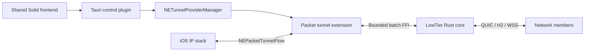

# iOS app

LowTier uses the existing Solid frontend in a Tauri 2 shell.
A separate `NEPacketTunnelProvider` extension runs the Rust core.
The app requires iOS 16 or later.
The source builds an unsigned device app. A signed device test remains necessary.

## Layout

The same frontend bundle serves the browser interface and the native app.
Tauri selects the app layout automatically.
The browser query `?layout=app` shows the layout without VPN controls.
The preview does not create peers or simulate a VPN connection.

| Tab | Purpose |
| --- | --- |
| Connect | System VPN state, connection control, overlay address, traffic, and available machines |
| Machines | Search network members and inspect transport, authentication, and traffic |
| Routes | Inspect the current overlay forwarding state |
| Settings | Replace the network profile, select appearance, and read recent logs |

The layout supports safe areas, enlarged text, and light and dark appearance.
The app polls the provider only while the VPN is connected and the app is visible.
“VPN active” reports the system connection state. Peer availability is a separate result.

## Native packet path



Packets do not pass through JavaScript or WebView IPC.
The public packet-flow API supplies and accepts IP packet batches.
The C FFI passes those batches to the existing NIC forwarding and authenticated transport paths.
The adapter retains the current routing, ACL, and encryption behavior.

Each batch contains at most 64 packets.
The existing ring capacity limits each direction to 128 queued packets.
The native input loop waits for capacity before requesting another OS batch.
Closing the interface cancels blocked input and waits for the final output callback.
Consumer closure wakes a producer that waits for packet credits.
One atomic claim prevents two interfaces from attaching to one instance.
Writer generations reject errors from superseded interfaces.

The extension fixes both interface MTUs at 1280 bytes.
Profiles require a static `address.ipv4`.
The OS captures that subnet and the explicit IPv4 routes in the profile.
A static IPv6 address also installs its subnet route.
Overlay route changes do not automatically change OS capture routes.
This version does not install VPN DNS settings or support DHCP address changes.

## Credentials and control

The shared Keychain stores the profile, network secret, and generated private identity.
Items use `kSecAttrAccessibleAfterFirstUnlockThisDeviceOnly`.
The extension saves a generated identity before it starts network operations.
Reconnects therefore retain the node identity.
Replacing a profile creates a new identity unless the imported configuration contains its existing private key.

VPN preferences contain only the profile ID.
Shared UserDefaults contain the last connection error.
Parser diagnostics that can contain configuration secrets do not reach shared diagnostics.
The frontend does not save network credentials in browser storage.
Imports must contain credentials directly. File references are rejected.

The extension disables the embedded Web UI.
The containing app uses provider messages for inspection.
Allowed methods are `GetNode`, `ListPeers`, `ListRoutes`, `ListPaths`, `GetStats`, `ReadLogs`,
`GetDiscovery`, `GetRelay`, and `ListListeners`.
The provider selects the instance ID and rejects other methods.
Profile replacement requires a disconnected VPN.

## Build and signing

Use macOS with a complete Xcode installation, Rust, `protoc`, pnpm, XcodeGen, and CocoaPods.
Use the repository Rust toolchain and Cargo caches.

From the repository root:

```sh
rustup target add aarch64-apple-ios aarch64-apple-ios-sim
cd lowertier/gui
pnpm install --frozen-lockfile
pnpm ios:init
```

`ios:init` generates the Tauri project and adds the packet extension.
It also generates the app icons from the source SVG.
It also writes the shared Keychain, App Group, and Network Extension entitlements.
After manual project regeneration, run `python3 script/ios/configure.py` from the repository root.

The default identifiers are:

| Item | Identifier |
| --- | --- |
| Containing app | `com.lowertier.app` |
| Packet extension | `com.lowertier.app.PacketTunnel` |
| App Group | `group.com.lowertier.app` |
| Shared Keychain | `$(AppIdentifierPrefix)com.lowertier.app.shared` |

Use a bundle identifier registered to your Apple Developer team.
Set the identifier in `lowertier/gui/src-tauri/tauri.conf.json` before project generation.
Select the same signing team for both targets in Xcode.
Register the shared App Group.
Include these capabilities in both provisioning profiles:

- Network Extensions with `packet-tunnel-provider`.
- App Groups.
- Keychain Sharing with the shared access group.

From `lowertier/gui`, run:

```sh
pnpm ios:dev
pnpm ios:build
```

Keep the Tauri command running when Xcode calls its generated Rust build phase.
That phase requires the CLI control server.
Vite uses `TAURI_DEV_HOST` for physical-device development.
It excludes the Rust and Swift build trees from file watching.
Release builds retain the bundled frontend and the stricter production content security policy.

The extension build phase runs:

```sh
cargo build --locked --release --target aarch64-apple-ios \
  -p lowertier-ffi --no-default-features --features c-abi,packet-tunnel
```

The shell uses a separate Cargo workspace under `lowertier/gui/src-tauri`.
Production shell builds enable `custom-protocol` to bundle the frontend.
The mobile core omits GUI, TUI, and optional allocator features.
Existing default FFI builds retain their previous core features.
The extension links the explicit static archive.
It does not load a core library from the build machine.

## Performance and additional access

Let `P` be packet count, `B` be payload bytes, and `N` be one OS input batch size.
The adapter performs `O(P + B)` work.
Input copies payloads into Rust packet storage.
Output copies payloads into `Data` before the callback returns.
Bridging input `Data` to `NSData` can add another copy.
The adapter uses no local packet sockets.

At 1 Gbit/s and 1280-byte packets, the payload rate is 125 MB/s and approximately 97,656 packets/s.
Full batches require approximately 1,526 FFI input calls/s.
Smaller or partial batches require more calls.
These estimates exclude transport overhead.

At MTU 1280, the two 128-packet rings can retain 327,680 payload bytes in total.
This bound excludes packet headers, metadata, allocator capacity, in-progress batches, and existing NIC queues.
The OS can retain a pending input batch of approximately `N × 1280` payload bytes.
The WebView runs separately from the VPN extension.
These source bounds do not establish process RSS, CPU cost, battery use, or device throughput.

WireGuard's Apple adapter obtains a tunnel descriptor by scanning process descriptors for `com.apple.net.utun_control`.
This avoids the Swift packet-flow bridge.
Its implementation does not establish a supported descriptor API in `NEPacketTunnelFlow`.
LowTier currently uses the public packet-flow contract.
No additional entitlement that grants a supported raw tunnel descriptor has been verified.

The increased-memory entitlement is device-dependent.
Apple requires correct operation without the additional memory.
Extra memory does not remove packet copies.
The app does not request additional memory.

Before selecting another packet API, compare both paths on the same signed device.
Record delivery rate, latency, loss, retransmissions, useful throughput, extension RSS, and CPU time per delivered Gbit.
Include IPv4, IPv6, small packets, MTU-sized packets, both directions, and network changes.
Separate startup and compilation from packet transfer.
No device performance improvement is claimed by this implementation.

## Verification

From the repository root:

```sh
cargo test --locked -p lowertier-ffi --no-default-features \
  --features c-abi,packet-tunnel -- --test-threads=1
cargo test --locked -p lowertier-ffi --lib -- --test-threads=1
```

The packet tests cover profile identity, packet integrity, bounded admission, and cancellation.
They also cover concurrent close, callback lifetime, ownership, reopen, and C/RPC lifecycle cleanup.
The Swift fixture covers borrowed pointers, IPv4/IPv6 metadata, and batch boundaries.
After building the app, check its embedded extension and runtime library paths:

```sh
python3 script/ios/check-bundle.py \
  lowertier/gui/src-tauri/gen/apple/build/release-iphoneos/LowTier.app
```

From `lowertier/gui`:

```sh
pnpm test
pnpm test:app
pnpm build
```

The browser tests cover layout widths from 320 to 820 pixels, enlarged text, appearance,
native command routing, credential storage, and system connection states.
Native IPC is mocked in those tests.
They do not establish a working signed VPN session.

On November 16, 2026, the unsigned arm64 app and packet extension built with the installed iOS SDK.
The Tauri production shell and the Rust device and simulator targets also compiled.
SDK validation used the compiled production shell and a generated Xcode project without the CLI Rust rebuild phase.
This host has no valid signing identity.
Its CoreDevice and CoreSimulator frameworks do not match Xcode 27.2.
SDK compilation works, but device installation and simulator execution remain unverified.
Complete build records are in `benchmark-results/.work/ios-app-20261116/`.

## References

- [Tauri mobile plugins](https://v2.tauri.app/develop/plugins/develop-mobile/)
- [Apple packet tunnel provider](https://developer.apple.com/documentation/networkextension/nepackettunnelprovider)
- [Apple packet tunnel flow](https://developer.apple.com/documentation/networkextension/nepackettunnelflow)
- [Network Extension entitlement](https://developer.apple.com/documentation/bundleresources/entitlements/com.apple.developer.networking.networkextension)
- [Increased memory limit](https://developer.apple.com/documentation/bundleresources/entitlements/com.apple.developer.kernel.increased-memory-limit)
- [WireGuard Apple adapter source](https://git.zx2c4.com/wireguard-apple/tree/Sources/WireGuardKit/WireGuardAdapter.swift)
